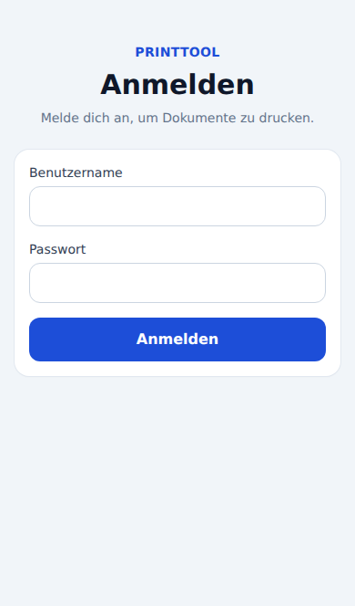
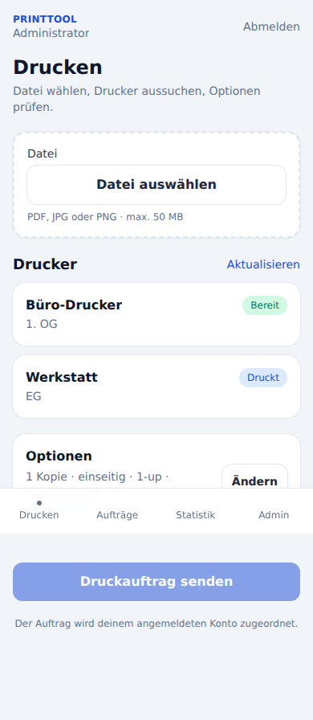
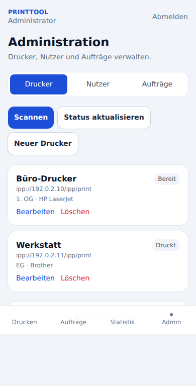
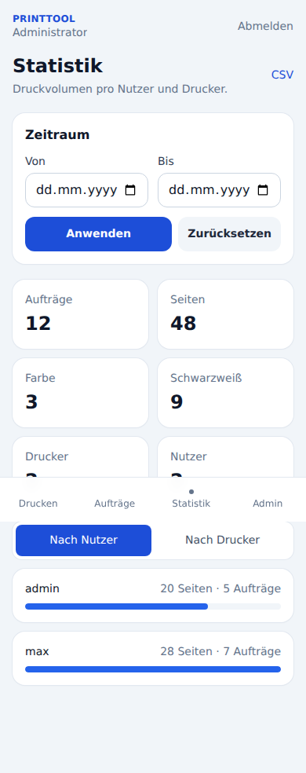

# PrintTool

Mobiler Druckserver für Netzwerkdrucker: CUPS im Docker-Container, FastAPI-Backend,
Vue-3-WebUI (mobile-first, deutsch) und lokale Benutzerverwaltung.

## Screenshots

| Login | Drucken | Administration | Statistik |
|---|---|---|---|
|  |  |  |  |

## Funktionen (Zielbild)

- Automatische Druckerkennung per mDNS/Bonjour und Subnetz-Scan
- Drucken aus der WebUI: PDF/JPG/PNG hochladen, Drucker wählen, Optionen setzen
- Optionen: Kopien, Seitenbereich, Doppelseitig, N-up, Farbe/Schwarzweiß, Papier
- Benutzerverwaltung: Admin und Nutzer; nur Admins legen Nutzer und Drucker an
- Statistik pro Nutzer und Drucker (Seiten, Kopien, Farbe/SW, Zeitraum)
- AirPrint bewusst deaktiviert, damit alle Aufträge einem Nutzer zugeordnet werden

## Schnellstart (Docker)

```bash
cp .env.example .env
# ADMIN_PASSWORD und JWT_SECRET in .env ändern!
docker compose up -d --build
```

Danach `http://<host-ip>:8000` öffnen und mit den Admin-Zugangsdaten aus `.env`
anmelden. CUPS läuft im Host-Netzwerk auf Port 631; dieser Port muss auf dem Host
frei sein (ggf. Host-CUPS stoppen).

## Entwicklung

Backend:

```bash
cd backend
python3 -m venv .venv
source .venv/bin/activate
pip install -r requirements.txt
uvicorn app.main:app --reload
pytest
```

Frontend (Node.js erforderlich):

```bash
cd frontend
npm install
npm run dev
npm run build
npm run lint
npm run test
npx playwright test
npx playwright test -c playwright.integration.config.ts
```

Die gemockten Playwright-Tests und visuellen Screenshot-Baselines liegen unter
`frontend/e2e/`. Details: `docs/testing.md`.

## Konfiguration

Siehe `.env.example`. Wichtige Variablen:

| Variable | Zweck |
|---|---|
| `ADMIN_USERNAME` / `ADMIN_PASSWORD` | Admin-Bootstrap beim ersten Start |
| `JWT_SECRET` | Signatur der Session-Cookies (min. 32 Zeichen) |
| `DATABASE_URL` | SQLite-Pfad, im Container `sqlite:////app/data/app.db` |
| `UPLOAD_DIR` | Upload-Verzeichnis, im Container `/app/uploads` |
| `UPLOAD_MAX_MB` | Maximale Uploadgröße |
| `DISCOVERY_ENABLED` | Periodische Druckererkennung ein/aus |
| `DISCOVERY_MDNS` | mDNS/Bonjour-Erkennung ein/aus |
| `DISCOVERY_SNMP` | SNMP-Anreicherung ein/aus (benötigt `snmpget`) |
| `DISCOVERY_SUBNETS` | Kommagetrennte Subnetze für den aktiven Scan |
| `DISCOVERY_INTERVAL` | Scan-Intervall in Sekunden |
| `SNMP_COMMUNITY` | SNMP-Community (Default `public`) |
| `JOB_SYNC_ENABLED` | CUPS-Jobstatus periodisch in die DB übernehmen |
| `JOB_SYNC_INTERVAL` | Intervall des Job-Status-Syncs in Sekunden |
| `COOKIE_SECURE` | `true` hinter HTTPS |
| `CUPS_ADMIN` / `CUPS_PASSWORD` | Optionaler CUPS-WebUI-Zugang |
| `CUPS_PDF_QUEUE` | Optionaler virtueller PDF-Drucker (z. B. `printtool-pdf` für E2E) |

## Architektur & Agenten

- `docs/architecture.md`: Komponenten, Datenmodell, API, Druckoptionen
- `docs/testing.md`: Test-Pyramide, Playwright, visuelle Tests, CUPS-PDF
- `docs/release.md`: Deployment, Backup, Abnahme-Checkliste
- `docs/agent-workflow.md`: Agent-Rollen, Ablauf, Commit-Regeln
- `AGENTS.md`: verbindliche Projektregeln
- `.opencode/agent/*.md`: Agent-Definitionen (alle `deepseek/deepseek-flash`)

## Status

**v0.8.1 – Release-Kandidat.** Alle geplanten Meilensteine sind umgesetzt:

- M0–M2: Repo/Agent-Doku, CUPS-Grundlage, API-Härtung und CRUD
- M3–M4: Discovery (mDNS/Subnetz/SNMP), Auto-Queues, Job-Status-Sync
- M5–M6: Mobile UI, Session-Refresh, Admin-UI, Statistik mit Zeitraumfilter
- M7: Playwright-E2E, visuelle Baselines, echter Integrationslauf
- M8: Changelog, Release-Doku, CI-Workflow

Offen vor Produktivbetrieb: Docker-Build und CUPS-PDF-E2E auf dem Zielhost
verifizieren (in der Sandbox war der Docker-Daemon gesperrt).
